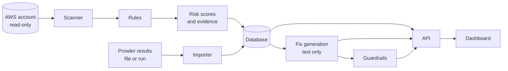

# CloudShield

CloudShield is a fix-first, evidence-first AWS posture tool, built from scratch as a student
capstone. It reads your account with read-only access, checks what it finds against six rules,
scores each finding using its context, shows the evidence behind the score, and says what to fix
first. For each finding it writes a fix as text that you review and apply yourself. It never
changes your AWS account. Results from Prowler can be imported and are shown beside CloudShield's
own findings, labelled as imported.

## The loop

1. **Scan.** Read the account with read-only AWS calls.
2. **Rank.** Score every finding from its severity and context, and sort them into Fix now, Next
   and Later.
3. **Fix.** Open a finding, read the evidence, and take the patch, the checks to make first and the
   guardrail that stops it coming back. You apply it.
4. **Verify.** Scan again. A finding is shown as resolved only after a rescan (or a newer import)
   confirms it.

## How it fits together



## Quick start

You need Python 3.12 and Node 20 or newer. All commands are PowerShell, from the repository root.

### Backend

```powershell
python -m venv .venv
.\.venv\Scripts\Activate.ps1
pip install -e ".[dev]"
Copy-Item .env.example .env
python -m alembic upgrade head
```

`.env.example` lists every setting with a one-line explanation. Fill in the ones you need in `.env`.
A variable already set in your shell wins over the file. The scan uses the AWS profile named in
`AWS_PROFILE` (the standard boto3 credential chain) and the region in `AWS_REGION`, or the regions
sent with the scan request.

```powershell
python -m uvicorn cloudshield.api.app:create_app --factory --port 8000
```

The server listens on 127.0.0.1 only. Keep it that way (see Safety).

### Frontend

```powershell
cd web
npm ci
npm run dev
```

Open http://localhost:5173 at exactly that address. The API refuses a write (a scan, a dismissal,
an upload, a fix) that comes from any other web address, and `localhost` and `127.0.0.1` count as
different addresses. To use another address, set `FRONTEND_ORIGIN` on the server. The web app reads
`VITE_API_URL` (default `http://localhost:8000`). It loads three fonts from Google Fonts and falls
back to system fonts if that is blocked.

### Look at it on demo data (no AWS account needed)

The demo builds a made-up AWS account with moto, runs the real scanner, rules and scoring on it,
scans again after a simulated fix, and imports a hand-written results file. Nothing in it is from a
real account, and the dashboard says so in a banner.

```powershell
python -m cloudshield.demo seed --db demo.db
$env:DATABASE_URL = "sqlite:///demo.db"
$env:FRONTEND_ORIGIN = "http://localhost:5173"
$env:AWS_PROFILE = "demo-no-such-profile"
python -m uvicorn cloudshield.api.app:create_app --factory --port 8000
```

In a second terminal run `npm run dev` in `web/` as above. The demo has findings in every lane,
three merged pairs, one disagreement between the two tools, a few imported-only findings, three
resolved findings and an active account-wide guardrail.

- The command stops if `demo.db` exists. `--force` replaces a file only if every scan in it is
  labelled as demo data, so it can never replace a real database.
- Setting `AWS_PROFILE` to a name that does not exist makes a stray click on Run scan fail before
  any AWS call. Do not run a real scan into `demo.db`: the banner then goes away, because the
  newest scan is no longer demo data.
- The demo needs moto, which `pip install -e ".[dev]"` installs.

## The six rules

| Id | Severity | What it reports |
|---|---|---|
| CIS-S3-001 | High | An S3 bucket does not block all public access |
| CIS-S3-002 | Info | A bucket's default encryption does not use a KMS key (not counted in the risk score) |
| CIS-S3-003 | Medium | S3 versioning is not enabled |
| CIS-SG-001 | High | A security group allows SSH or all traffic from the internet |
| CIS-IAM-001 | High or Medium | A customer-managed IAM policy allows all actions (High) or all resources (Medium) |
| SX-IAM-PRIVESC-001 | High | IAM permissions match one of 15 known privilege-escalation methods |

The ids are CloudShield's own names, not references to a benchmark. A rule never reports a finding
for a value it could not read. Scores start from the severity (Critical 90, High 70, Medium 40,
Low 20) and add context: +15 when a bucket or security group is configured to be reachable from the
internet, +10 when a security group is attached to a running instance, +10 when a policy is
attached to something. Fix now is a score of 80 or more, Next is 60 to 79, Later is below 60. See
`docs/risk-scoring.md`.

## Imported findings

You can import the JSON-OCSF results of [Prowler](https://github.com/prowler-cloud/prowler) in
three ways: `python -m cloudshield.imports prowler <file>`, "Import a results file" in the dashboard's
Run scan menu, or "Run full scan", which starts Prowler for this computer's account. They are shown
beside CloudShield's own findings and always labelled Imported.

- Imported evidence is **reported**, never verified: CloudShield did not collect it.
- Imported findings get no patches and no AI text. The Fix page shows the scanner's own advice, and
  for 13 checks a short "What to do" written by CloudShield from AWS documentation. Check it against
  the page it links to before you act.
- The score comes from the severity alone. Our own context is added only when the same resource is
  in our own scan.
- When an imported check tests exactly what one of our rules tests (three S3 checks) and both
  fail, it is shown once, as ours, with "also reported by an imported scan". When they disagree,
  both stay visible and are flagged.
- An imported finding is resolved only when a newer import shows the same check and resource as
  passing. One that a newer import leaves out stays open and is marked "not rechecked".
- The dashboard names the scanner only where an install or run command needs it. Credit is in
  `docs/third-party.md` and below.

See `docs/extended-checks.md` for installing Prowler, and `docs/limitations.md` for every detail.

## Guardrails

A fix repairs what is wrong now. A guardrail ("Prevent it coming back") is text that makes the
problem harder to bring back: an account-wide setting, a check for your build pipeline, an AWS
Config rule, or an organization policy. Like a fix, you apply it yourself. Each one shows a status
read from your last completed scan each time you look:

| Status | Meaning |
|---|---|
| Active | A scan read the setting and found it on. Only the account-wide S3 public access block can be active |
| Not active | A scan read the account and the setting is missing or off |
| Unknown | CloudShield cannot see it (your pipeline, AWS Config rules), or the read failed |
| Needs organization admin | Only your organization's management account can apply or read it |

"Active" is never shown without a read that found it on. The scan reads the account-wide block, so
the read-only policy needs `s3:GetAccountPublicAccessBlock`. See `docs/guardrails.md`.

## Docker mode

Instead of installing Prowler, set `PROWLER_MODE=docker` in `.env` (Docker Desktop must be running)
and, for repeatable results, pin `PROWLER_DOCKER_IMAGE` to a version tag. `python -m cloudshield.imports check-runner`
checks Docker and the image without starting a scan. Put `CLOUDSHIELD_DATA_DIR` outside OneDrive.
The container sees only its run folder and the AWS credentials of the server's profile. See the Docker
section of `docs/extended-checks.md`.

## Honesty rules

- A result is called verified only when a scan found the evidence. Imported evidence is "reported".
- Unknown is not fixed. A finding is resolved only after a rescan or a newer import confirms it,
  and not when the scan could not read what its rule needs.
- Data from mocks or made-up files is labelled as such, in the files, the docs and the dashboard.
- Rule ids are CloudShield's own. No citation or benchmark number is invented.
- A fix says what CloudShield did not check, and never calls a change safe.
- The optional AI explanation is text only, is checked against the data, and is never used for
  imported findings. See `docs/ai-data.md` for exactly what is sent.

## Safety

- AWS access is **read-only**. Use the policy in `docs/aws-readonly-policy.json` (explained in
  `docs/aws-permissions.md`). Nothing CloudShield writes is ever run for you.
- Run the server on localhost only, and never expose the port. Anyone who can reach it can start
  scans with the server's AWS credentials, read all findings and upload files. There is no login.
- Never commit `.env`, a database, or a scan or Prowler output file: they hold real account data and
  keys. `.gitignore` covers them. Secrets come from the environment only.
- The dashboard masks 12-digit account ids in titles and evidence. This is a display change, not a
  guarantee (see `docs/limitations.md`).

## Experiments

`experiments/` measures two things on synthetic data only (fake accounts made with moto and
hand-written files), for the research paper: whether the resolver keeps a finding open when a scan
or import could not confirm something (E1), and whether the patches CloudShield writes are valid
for the tool that runs them (E4). Rerun them with:

```powershell
python -m experiments.run_all
```

This rewrites the CSV files in `experiments/results/`. E1 takes about 40 seconds. The Terraform and
CloudFormation checks of E4 need extra tools; see `experiments/README.md`.

## Numbers for the paper

```powershell
python -m cloudshield.report numbers --db demo.db --out numbers.md --csv numbers.csv
```

It reads the database only and prints and saves findings by rule, severity and lane, merged pairs,
resolved findings with their dates and reasons, scans, imports, guardrail statuses, versions, the AI
model names and the experiment summaries. Account ids and resource names are replaced by aliases, so
the output is safe to share. Test counts are left for you to fill in. Run
`python -m alembic upgrade head` on a database made before this version first.

## Tests

From the repository root:

```powershell
python -m pytest -q
```

Then in `web/`:

```powershell
npx prettier --check .
npm run build
npm test
```

`pytest` runs the whole Python suite on mocked AWS (moto) and a mocked Gemini, with no network,
credentials or key. `npm test` runs the vitest suite against a mocked API. Continuous integration
also runs `ruff check` and `ruff format --check`.

Two Playwright suites open the real dashboard in your installed Chrome or Edge: `npm run e2e`
(read-only) and `npm run e2e:actions`
(**scans your real AWS account**, may call Gemini and Docker, and refuses to start unless you
confirm). They are never run by CI. See `docs/browser-tests.md`.

## Limitations

- Real-account checks covered S3 buckets, security groups and customer-managed IAM policies. EC2
  instances and IAM roles are verified with mocks only, and EC2 data with a real account in one
  region only.
- The privilege-escalation rule checks 15 methods and ignores permission boundaries, service
  control policies and resource policies. Exposure is configuration only: route tables and network
  ACLs are not checked.
- Only one scan or import runs at a time, in one server process. The AI hour limit lives in that
  process's memory.
- Only Prowler 5.44.0 output has been checked. Docker mode was run by hand once, on Windows.
- Moto is not AWS, so the demo and the experiments show behavior on small made-up accounts.

The full list is in `docs/limitations.md`.

## Credits

Imported results come from [Prowler](https://github.com/prowler-cloud/prowler), licensed under the
Apache License 2.0. The version whose output was checked is 5.44.0. CloudShield does not bundle
Prowler or copy any of its code. The guardrail workflows name [Checkov](https://github.com/bridgecrewio/checkov)
(Apache-2.0) checks, and the import format is OCSF 1.5.0. See `docs/third-party.md`.

## Project layout

```
src/cloudshield/
  config.py  findings.py  dispositions.py
  scanner/      read-only AWS discovery
  rules/        the six rules and their evidence
  risk/         scores and context
  fixes/        fix text, optional explanation, export
  guardrails/   "Prevent it coming back" and their status
  imports/      Prowler import, run, merge and guidance
  ai/           knowledge for fix explanations only
  api/          FastAPI routes and response shapes
  db/           models, store and migrations
  demo/         the demo data seed
  report/       the numbers command
tests/          the Python test suite
web/            React, TypeScript, Vite and Tailwind
docs/           guides and limitations
experiments/    the research experiments
```
